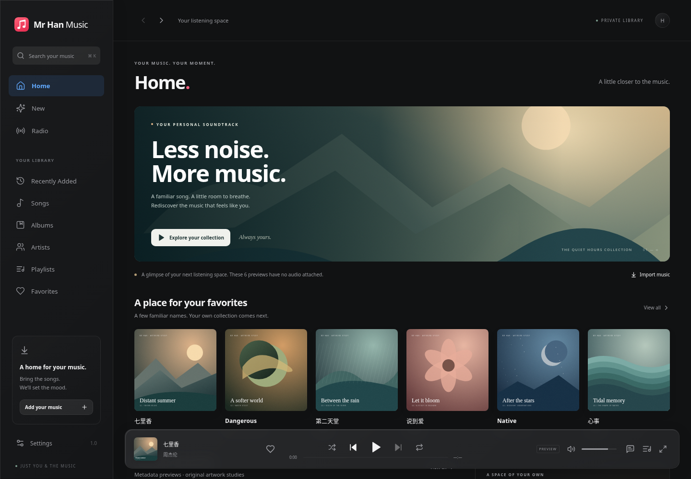

# Mr Han Music

一个私人使用的 Web 音乐播放器。React、TypeScript strict、Vite、Zustand、Framer Motion；原生 `HTMLAudioElement` 解码，不引入 WebAudio DSP，不转码、不归一化、不修改源文件。

已实现一阶段可运行工程，包括真实文件导入、资料库浏览、队列、播放页、同步歌词、收藏与本地恢复。初次启动显示 6 首**明确标识的元数据预览**，没有附带这些歌曲的录音或歌词。预览插画是原创视觉素材，不是官方专辑封面。首次导入真实音乐后，预览自动退场。



## 运行

建议 Node.js 22.12+ 或 24，npm 10+。

```bash
npm install
npm run dev
```

打开终端显示的本地地址。点击 **Import music**，导入自己的 FLAC / WAV / MP3 / M4A。文件与提取出的封面保存在当前浏览器的 IndexedDB；不会上传到第三方。

```bash
npm run lint
npm run typecheck
npm run test
npm run build
npm run preview
```

浏览器测试：

```bash
npx playwright install chromium
npm run test:e2e
npm run test:pwa
```

如果系统已有 `/usr/bin/chromium`，测试会使用它。测试音频由程序生成，不包含商业录音。格式化源码可运行 `npm run format`。

## 已实现

- Home、New / Recently Added、Library Radio、Songs、Albums、Artists、Playlists、Favorites、Recently Played、Search、Settings，以及独立专辑和歌手页面。
- 原生播放、暂停、上一首 / 下一首、进度跳转、音量、随机播放、循环、缓冲状态、错误提示和重试。媒体键与 Media Session 元信息、进度及 seek action handlers。
- Mini Player → Now Playing 的共享封面；完整播放页、全屏封面、专辑配色背景；桌面双栏歌词，手机沉浸歌词。
- LRC、多时间标签、offset、双语同时间标签、enhanced LRC 逐字时间、rich JSON。点击歌词 seek、带速度连续性的弹簧跟踪、手动滚动后返回当前歌词、翻译 / 注音开关、器乐段指示。
- 队列插入下一首 / 最后、拖拽与键盘可操作的上下移动、单独移除、清空；歌曲菜单、创建歌单与加入歌单。
- 中英文多关键字检索、专辑 / 歌手聚合、歌曲排序、无损筛选；歌曲、专辑和歌手收藏；真实播放统计与历史。
- System / Light / Dark；红粉音乐情绪色、蓝色选中态、黑白系统控制。四种基础玻璃和语义材质、轻折射、反光、按压反馈与质量档位。
- 当前曲目、队列、播放位置、音量、随机 / 循环、主题、收藏、历史和歌单保存于 IndexedDB。刷新恢复位置，**不自动播放**。
- PWA manifest、PNG 图标、带内容版本的 Service Worker；应用壳、分块脚本、本地预览素材和公开元数据离线缓存，**不缓存远程大型音频**。
- 本地 metadata 扫描、Cloudflare 私有 R2 Worker、单段 Range 流式读取、Access JWT 验签、CI 和自动测试。

## 项目结构

```text
src/
  audio/          单一原生解码器、媒体事件与 Media Session
  components/     应用运行时、导入、歌曲行、对话框与通用控件
  features/       Home、Library、Album、Artist、Search、Settings 等页面
  glass/          语义材质、SVG 折射、封面配色提取
  library/        演示目录、聚合、检索、浏览器原始文件导入
  lyrics/         LRC / JSON 解析、弹簧跟踪、歌词界面
  motion/         统一 spring tokens
  player/         Mini Player、Now Playing、Queue
  storage/        IndexedDB 与 Zustand 状态
  utils/          时间、音源质量、分组辅助
cloudflare/       私有媒体 Worker、Range parser、Wrangler 配置
scripts/          本地 metadata 扫描与显式上传脚本
public/           空资料库、原创插画、PWA、Pages 配置
tests/            数据 / 歌词 / 队列 / Range / JWT 测试
e2e/              浏览器真实导入与播放流程
docs/             架构、Cloudflare 部署、验证记录和预览图
```

## 导入歌词

展开播放器 → 打开歌词 → **Import lyrics**。导入 `.lrc` 或 `.json`，并与当前曲目绑定；跨刷新保留。示例和统一类型见 [架构说明](docs/ARCHITECTURE.md)。也可在远程 Track 数据中设置 `lyricsUrl`。

## 扫描自己的资料库

```bash
npm run scan-library -- /absolute/path/to/music --out private-library --base-url /media
```

递归读取 ID3 / FLAC / M4A / WAV metadata，提取内嵌封面、同名 `.lrc` / `.json`；输出 `library.json` 和 `upload-manifest.json`。音频只读取，不复制、不改写；内容哈希作为稳定 Track ID。扫描失败会逐项报告并以非零状态退出。

`private-library/`、`library-files/` 和音频扩展名默认被 Git 忽略。不要把私人音乐、上传清单或凭据提交到 GitHub。

## Cloudflare 部署

架构：GitHub 保存代码 → Cloudflare Pages 提供应用 → 同域 `/media/*` Worker → Private R2。Pages 与媒体路径共同由 Cloudflare Access 的本人邮箱策略保护。

具体操作见 [部署说明](docs/DEPLOYMENT.md)。当前交付没有连接真实 Cloudflare 账户，也没有上传或公开任何文件。需要你自己的 Cloudflare 账号、域名、R2 Bucket 和 Access audience 才能部署私人服务。

## 实际边界与下一阶段

- `Lossless` / `Hi-Res Lossless` 只描述**源文件**。浏览器与 OS 的输出格式、DAC 实际采样率、bit-perfect 无法由普通网页保证。
- 下一首只预加载 metadata；不宣称已实现严格 sample-accurate gapless。浏览器对 FLAC、ALAC、超高采样率与后台播放的支持各不相同。
- Glass 使用 Web 光学近似。High 的 SVG backdrop refraction 因浏览器而异；Balanced / Reduced 有降级。Auto 是设备与无障碍偏好的启发式选择，不是帧率基准测试。
- 已有逐字时间和 rich JSON 架构；TTML 适配器尚未实现。不会下载或生成商业歌曲歌词。
- 歌单目前支持创建、查看和加入歌曲；重命名、删除歌单、批量编辑和跨设备同步留在后续阶段。
- 本地导入只属于当前浏览器资料库。浏览器可能清理存储；设置页可请求 persistent storage，源文件仍应另行保留。
- 远程私有 `/media/*` 默认不写入 Service Worker Cache；因此不承诺远程音乐、封面、歌词离线可用。本地导入及本地附加歌词可离线使用。
- 自动验证与视觉检查使用 Chromium；Safari / iOS 实机、蓝牙键、锁屏、120 Hz 真机性能和真实 Cloudflare Access / R2 环境仍需下一阶段验证。

最值得继续的工作：接入你的真实资料库与私有部署，然后针对 iPhone / Safari 和真实 24-bit FLAC / ALAC 做播放兼容性、后台恢复与手势调优。

完整验证证据见 [QA 记录](docs/QA.md)。
